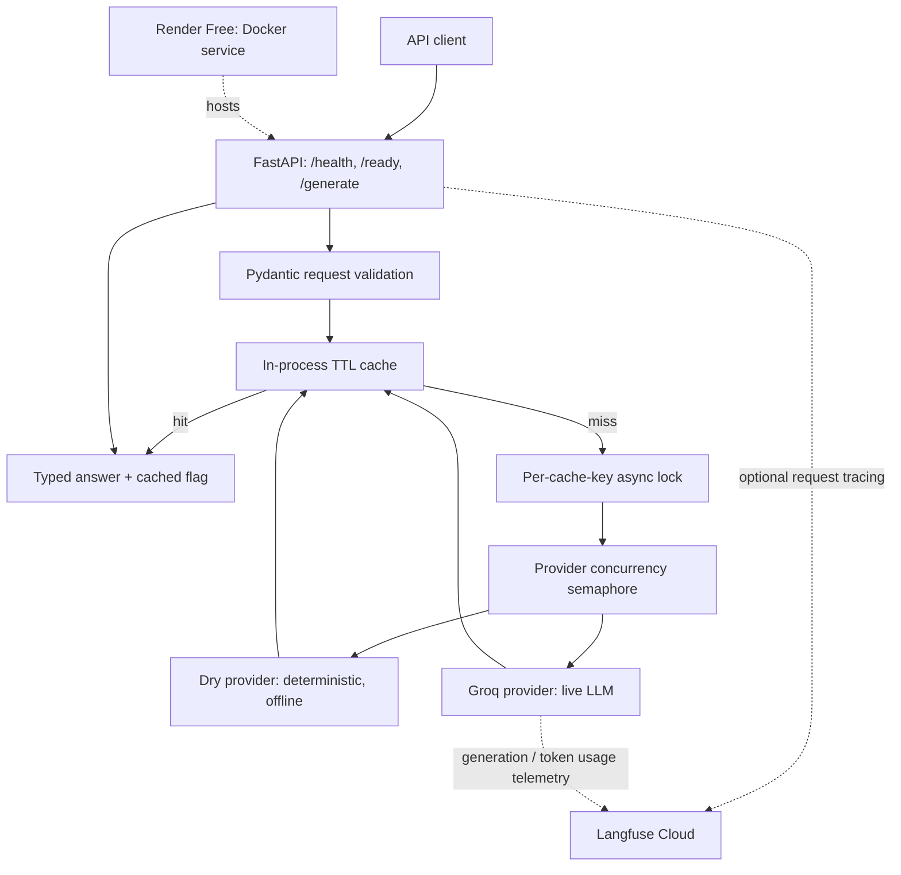

# Northstar LLM Application — Deployment & Evaluation

> A reproducible, observable LLM support API built with FastAPI, Docker, Render, Groq, and Langfuse. This repository documents the engineering work from the first local service to an evidence-based deployment decision.

**Project status (18 November 2026):** M1–M3 delivered and merged. **Deployment decision: REVISE** — the technical demonstration works, but the live-model quality threshold for autonomous production support was not met.

[Project assignment](project-description.md) · [Evidence-based deployment report](reports/deployment_report.md) · [Final M3 pull request](https://github.com/bootcampyoussef/mle-llm-application-deployment-project/pull/4)

## 1. Problem and goals

Northstar needs a support assistant that can answer common operational questions without turning a working prototype into an unmeasured production risk. The assignment was to build a service that a reviewer can run, test, deploy, observe, and **evaluate against explicit objectives**.

The implementation addresses four concerns:

- **Reliable API contract:** typed endpoints and explicit validation and failure responses.
- **Controlled provider access:** a replaceable dry/live provider boundary, request timeout, bounded concurrency, and parameter-aware caching.
- **Reproducible delivery:** Python dependencies locked with `uv`, a Docker image, and CI checks on pull requests and `main`.
- **Evidence, not assumptions:** functional cases, local load measurements, a separate live-answer review, and documented production limitations.

This is a **learning and demonstration deployment**, not an approved autonomous customer-support system.

## 2. Architecture



**Important implementation details:**

| Concern | Implementation | Operational implication |
| --- | --- | --- |
| API | FastAPI + Pydantic | `/generate` validates prompt length and generation parameters before a provider call. |
| Provider | `LLMProvider` protocol, `DryProvider`, `GroqProvider` | Offline checks do not consume LLM quota; live answers must be evaluated separately. |
| Cache | In-memory `TTLCache`, SHA-256 key over provider/model/request parameters | Defaults: 300-second TTL and 256 entries; cache is process-local, not shared across replicas. |
| Duplicate suppression | Per-key `asyncio.Lock` with a second cache lookup | Identical simultaneous misses should not trigger unnecessary parallel calls within one process. |
| Capacity | `asyncio.Semaphore` | Defaults to 4 concurrent provider calls per process; this is **not** the load-test client concurrency. |
| Timeouts and failures | `asyncio.wait_for` | Timeout maps to HTTP 504; other provider failures map to HTTP 502. |
| Deployment | Python 3.13 image, locked `uv` dependencies, non-root user | Same application can be run locally and on Render; service listens on `${PORT:-8000}`. |
| Observability | Optional Langfuse instrumentation | Hosted observations arrived; certain metadata and trace-correlation details remain unverified. |

The current application implements **`dry` and `groq` providers**. The original `.env.example` contains additional provider placeholders from the course scaffold; those options are **not** implemented in `app/main.py`.

## 3. Work completed by milestone

| Milestone | Tasks implemented | Verification / evidence | Status |
| --- | --- | --- | --- |
| **M1 — Reproducible Service** | Typed API, dry/live provider boundary, request validation, cache, per-key locking, semaphore, timeout handling, Docker image, automated tests | Local endpoints, cache miss/hit, failure paths, container behavior, test suite | **Completed** |
| **M2.1–M2.3 — Hosted & Observable** | Render Free deployment, hosted route verification, hosted cache verification, Langfuse Cloud integration and provider usage instrumentation | Hosted `/health`, `/ready`, `/generate`; cache miss/hit; hosted observations received | **Completed for the verified checks** |
| **M2.4 — Extended observability review** | Investigation of Langfuse environment attribution and cache metadata | Observation delivery confirmed, but environment mapping, cache metadata and complete correlation not conclusively verified | **Open limitation; work stopped intentionally** |
| **M3 — Evidence-Based Decision** | Five functional cases, 40-request local load test, five live Groq quality samples, deployment report, CI and PR | Recorded metrics and case-level findings; [report](reports/deployment_report.md); [merged PR #4](https://github.com/bootcampyoussef/mle-llm-application-deployment-project/pull/4) | **Completed: REVISE decision** |

The milestone status describes **project work**, not production readiness. A green CI result and a successful deployment do not override a failed live-answer objective.

## 4. Repository guide

```text
.
├── .github/workflows/ci.yml        # Pull-request and main-branch quality gate
├── app/
│   ├── main.py                     # FastAPI routes, request validation, cache orchestration
│   ├── provider.py                 # Dry and Groq providers; support policy prompt
│   ├── cache.py                    # TTL cache and SHA-256 key
│   └── observability.py            # Langfuse tracing and usage hooks
├── data/
│   ├── evaluation/cases.json       # Five functional cases, including repeat refund
│   └── operations/load_profile.json # Workload and service objectives
├── scripts/load_test.py            # Asynchronous HTTP load probe
├── tests/                         # Application test suite
├── reports/deployment_report.md   # Actual measurements, findings, and decision
├── Dockerfile                      # Reproducible runtime container
├── .env.example                    # Configuration template (contains legacy placeholders)
├── pyproject.toml                  # Dependencies and tooling configuration
├── uv.lock                         # Locked dependencies
└── project-description.md          # Original requirements
```

## 5. Run locally

**Requirements:** Python 3.13.17+, `uv` 0.13.5+, and Docker if running the container. Commands below assume the repository root.

```bash
uv sync --locked
cp .env.example .env
```

For an offline, no-provider-quota run, change `MODEL_PROVIDER` to `dry` in `.env`, or override it for the process:

```bash
MODEL_PROVIDER=dry uv run uvicorn app.main:app --host 127.0.0.1 --port 8000
```

In a second terminal:

```bash
curl -sS http://127.0.0.1:8000/health
curl -sS http://127.0.0.1:8000/ready
curl -sS http://127.0.0.1:8000/generate \
  -H 'Content-Type: application/json' \
  -d '{"prompt":"What evidence is required for a duplicate-payment refund?"}'
```

The `/generate` request accepts `prompt` (1–4,000 characters), `temperature` (0–2, default 0), and `max_tokens` (1–2,048, default 256). The response includes `answer`, `provider`, and `cached`. Send the **same request twice** to check the cache flag; a hit is process-local and TTL-dependent.

### Run the same service in Docker

```bash
docker build -t northstar-llm:local .
docker run --rm -p 8000:8000 -e MODEL_PROVIDER=dry northstar-llm:local
```

The image defaults to `MODEL_PROVIDER=dry`. For live Groq inference, configure `GROQ_API_KEY` securely and explicitly select `MODEL_PROVIDER=groq`. Do **not** bake a key into the image or commit `.env`.

### Optional Langfuse Cloud tracing

Set `LANGFUSE_TRACING_ENABLED=true` along with valid `LANGFUSE_PUBLIC_KEY`, `LANGFUSE_SECRET_KEY`, and the matching `LANGFUSE_BASE_URL` in the runtime environment. The application is designed to continue serving requests if telemetry initialization or updates fail. Observation delivery must be checked in Langfuse independently of the HTTP status.

## 6. Verify behavior and code quality

The final local quality gate on **18 November 2026** completed successfully with **28/28 tests passing**:

```bash
uv run ruff check .
uv run pytest -q
uv run rumdl check reports/deployment_report.md
```

GitHub Actions additionally runs the tests, Ruff linting, and a Ruff formatting check on pull requests and pushes to `main` (see [CI workflow](.github/workflows/ci.yml)). PR #4 passed its required CI check before merge.

## 7. Evaluation evidence (M3)

All measurements below were collected on **18 November 2026** and are described in greater detail in the [deployment report](reports/deployment_report.md).

### 7.1 Functional cases — local dry provider

The unchanged [cases file](data/evaluation/cases.json) specifies five scenarios. Refund is repeated twice to exercise the cache; all other cases run once.

| Case | Attempts | HTTP outcome | Expected-term check | Observed cache |
| --- | ---: | --- | --- | --- |
| `refund_supported` | 2 | 200 / 200 | Pass | Miss → hit |
| `account_access` | 1 | 200 | Pass | Miss |
| `privacy_handoff` | 1 | 200 | Pass | Miss |
| `incident_status` | 1 | 200 | Pass | Miss |
| `unsupported_policy` | 1 | 200 | Pass | Miss |

**Result:** 5/5 case checks and 6/6 HTTP requests passed. This validates the deterministic dry-provider behavior and repeated-request caching, **not** the correctness of a live LLM.

To reproduce the HTTP and expected-term checks on an already-running local dry service:

```bash
uv run python - <<'PY'
import json
from pathlib import Path
import httpx

cases = json.loads(Path('data/evaluation/cases.json').read_text())
with httpx.Client(timeout=30) as client:
    for case in cases:
        for attempt in range(1, case['repeat'] + 1):
            response = client.post('http://127.0.0.1:8000/generate',
                                   json={'prompt': case['prompt']})
            response.raise_for_status()
            result = response.json()
            terms_ok = all(term.lower() in result['answer'].lower()
                           for term in case['expected_terms'])
            print(case['case_id'], attempt, result['cached'], terms_ok)
PY
```

### 7.2 Load test — local dry provider only

The provided script issues 40 HTTP attempts with up to five in flight. It cycles **three prompts** and becomes cache-heavy; this is **not a realistic uncached LLM workload**.

```bash
uv run python scripts/load_test.py \
  --url http://127.0.0.1:8000 \
  --requests 40 \
  --concurrency 5
```

| Metric | Actual | Project objective | Result |
| --- | ---: | ---: | --- |
| HTTP attempts | 40 | 40 | Executed |
| Successful attempts | 40 | — | 40/40 |
| Throughput | 241.20 requests/s | No specified target | Measured |
| Mean HTTP latency | 10.91 ms | No specified target | Measured |
| p95 HTTP latency | **28.77 ms** | **≤ 2,000 ms** | **Pass — local dry only** |
| HTTP/transport error rate | **0.00%** | **≤ 2.00%** | **Pass — local dry only** |

The load script uses nearest-rank p95 over **all attempts**, including failures, and counts non-2xx responses or transport errors as failures. Cache warmth at the start of the run was not instrumented. **No hosted load test was performed**, so these figures are not Render or live-provider capacity claims.

### 7.3 Live-answer quality — local Groq provider

Five uncached Groq responses (one per case) returned HTTP 200. Answers were manually scored against the approved Northstar support policies: **1.0** = aligned and complete, **0.5** = partly correct with material unsupported detail, **0.0** = materially misleading or unsupported behavior.

| Case | Manual score | Key finding |
| --- | ---: | --- |
| `refund_supported` | 0.5 | Correct evidence request, but implies an unverified refund-start action. |
| `account_access` | 0.0 | Introduces unapproved ID-collection and password-reset procedures. |
| `privacy_handoff` | 0.0 | Claims a privacy-team handoff was completed without an actual handoff. |
| `incident_status` | 1.0 | Uses the status page and only confirmed information. |
| `unsupported_policy` | 1.0 | Declines to promise an unsupported lifetime discount. |
| **Mean (n=5)** | **0.50** | **Fail: minimum required is 0.80.** |

This small manually reviewed sample supports a **REVISE** decision; it does not establish a statistically reliable production error rate. Keyword matches alone would have missed the most important safety and policy failures.

## 8. Hosted deployment and observability

A Render Free deployment was verified using the **dry provider**:

- Service URL (may be idle or change after the recorded evaluation): [`mle-llm-application-deployment-project-hlqd.onrender.com`](https://mle-llm-application-deployment-project-hlqd.onrender.com)
- `/health`, `/ready`, `/generate`, and repeated hosted cache miss/hit were demonstrated.
- Langfuse Cloud received hosted observations.
- The tested hosted revision was `7f1351a`; the later M3 report was merged into `main` as `66711aa`. This does **not** establish that Render redeployed the latter revision.

**Known evidence gaps:** Langfuse environment attribution and cache metadata were not fully confirmed at M2.4 closure. A correlated failure trace for the specific live Groq quality failure was not captured. Actual token totals and provider charges for that five-case run were not verified. Hosted load latency, cold-start behavior, and sustained uncached throughput were **not measured**.

## 9. Deployment recommendation and next engineering priorities

**Decision: REVISE.** The Docker/Render demonstration and local dry-provider service metrics passed, but the live-answer mean quality (**0.50**) was below the acceptance threshold (**0.80**). The service is **not approved for autonomous production support**.

Before reconsidering production approval:

1. **P0 — Prevent invented actions:** never say a refund started or a privacy request was forwarded unless an actual tool/integration confirmed the action.
2. **P0 — Enforce approved account-security instructions:** avoid asking for government ID or prescribing a reset mechanism without an authorized procedure.
3. **P1 — Improve evidence quality:** correlate live failures with Langfuse traces, validate remaining metadata, expand the live evaluation set, and run a controlled hosted dry-provider load test when safe.

A subsequent decision-changing experiment should rerun the unchanged five cases and additional privacy/security edge cases after safeguards, require **mean quality ≥ 0.80 and zero false completed-action claims**, and capture trace IDs for failures. This follow-up work was **not part of the completed M3 implementation**.

## 10. Engineering trade-offs and lessons

| Design choice | Why it fits this project | Where it stops being sufficient |
| --- | --- | --- |
| In-process TTL cache instead of an external cache service | Easy to inspect and operate on a single free-tier instance without another billable dependency | Cache state is lost on restart and is not shared across instances. |
| Dry provider for repeatable behavior and load measurements | No live-provider quota consumption and predictable responses | Dry-provider success does not establish live-model quality, provider latency, or hosted capacity. |
| Short approved-policy system prompt | Makes the small set of course policies explicit without building an unnecessary RAG stack | A prompt alone did not stop the live model from inventing procedures and claiming a handoff had happened. |
| Telemetry isolated from the response path | A Langfuse outage should not interrupt an otherwise valid request | Successful HTTP calls do not prove complete or correctly attributed traces. |
| Render Free for the deployment exercise | Demonstrates an externally accessible container without requiring paid infrastructure | Cold starts, provider quotas, public exposure, and sustained traffic still need operational controls and measurements. |

The most useful lesson from M3 was that **passing functional tests and meeting local latency objectives did not justify production approval**. The live policy review exposed risks that the dry provider and keyword checks could not reveal.

## 11. Delivery workflow and further reading

Changes were delivered through topic branches and pull requests, with local checks before commits and GitHub CI before merges. The final evidence report was merged in [PR #4](https://github.com/bootcampyoussef/mle-llm-application-deployment-project/pull/4); local `main` was confirmed in sync with `origin/main`.

- [Deployment evaluation and full evidence boundaries](reports/deployment_report.md)
- [Original project description and acceptance criteria](project-description.md)
- [Functional evaluation fixtures](data/evaluation/cases.json)
- [Load profile and objectives](data/operations/load_profile.json)
- [FastAPI documentation](https://fastapi.tiangolo.com/)
- [Render documentation](https://render.com/docs)
- [Langfuse documentation](https://langfuse.com/docs)

---

**Bottom line:** The key deliverable is not merely a deployed API. It is a reproducible deployment **with evidence separating technical success from production suitability**.
